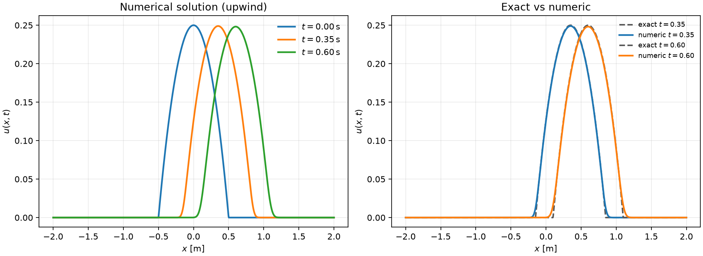
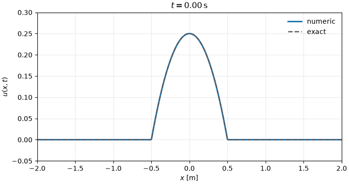
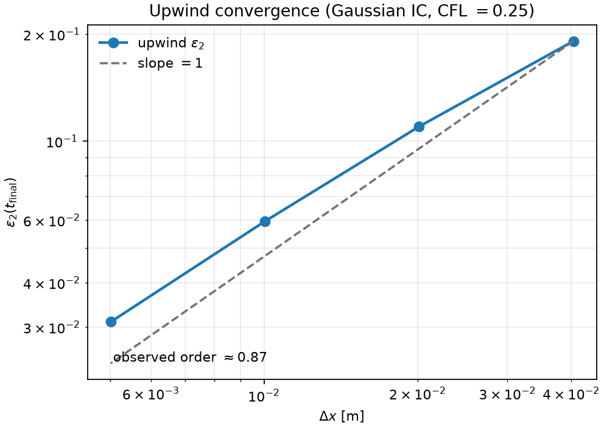
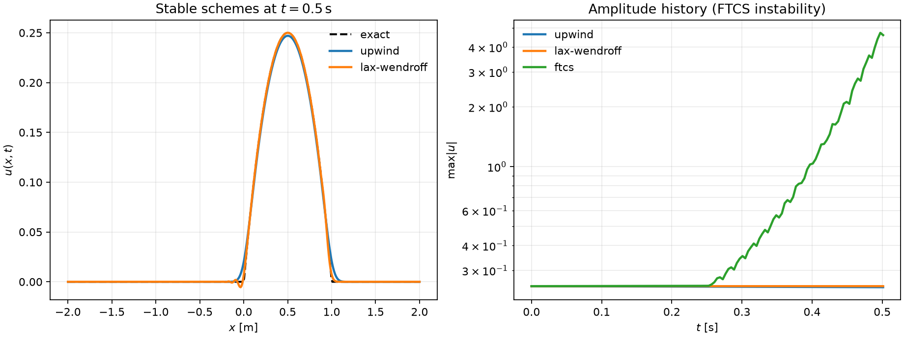

# 1D Linear Advection — Numerical Case Study

A compact scientific-computing portfolio piece by **Juan David Prada Malagon**: the one-dimensional linear advection equation is discretized with explicit finite-difference schemes in C, then verified against the exact traveling-wave solution and analyzed in Python.

$$
\frac{\partial u}{\partial t} + c \frac{\partial u}{\partial x} = 0
$$

<p align="center">
  
</p>

<p align="center">
  
</p>

## Author

- **Juan David Prada Malagon** — Data Scientist
- Email: [pradamalagonjd@gmail.com](mailto:pradamalagonjd@gmail.com)
- GitHub: [juandapradam12](https://github.com/juandapradam12)

See also [`CITATION.cff`](CITATION.cff).

## Why this case study

Advection is a minimal hyperbolic PDE that still exposes the design choices that matter in production solvers: CFL stability, upwind bias, numerical diffusion, scheme comparison, and verification against a known exact solution. The repository keeps the physics small so the software structure stays easy to inspect.

## Architecture

| Layer | Role |
| --- | --- |
| `include/advection.h`, `src/advection.c` | Problem API: configuration, schemes, exact field, CSV export |
| `src/main.c` | CLI driver (`--scheme`, `--n-points`, `--dt`, snapshots, …) |
| `python/` | Profiles, convergence study, scheme comparison, animation |
| `tests/test_solver.c` | Lightweight solver checks (`make test`) |
| `docs/methodology.md` | Governing equation, discretizations, and error metric |

Build orchestration lives in the `Makefile`. Simulation data is written under `data/`; figures under `docs/assets/`.

## Default experiment

| Parameter | Value |
| --- | --- |
| Advection speed $c$ | $1.0\,\mathrm{m/s}$ |
| Domain | $x \in [-2, 2]$ |
| Grid points $N$ | $1000$ |
| Time step $\Delta t$ | $10^{-3}\,\mathrm{s}$ |
| Steps | $700$ |
| Snapshots | $t \in \{0,\,0.35,\,0.60\}\,\mathrm{s}$ |
| Default scheme | first-order upwind |
| Initial data | compact parabola $u_0(x) = -x^{2} + 1/4$ for $\|x\| \le 1/2$ |

The continuum solution is the rigid translate $u(x,t) = u_0(x - c t)$. With CFL number $\nu = c\Delta t/\Delta x < 1$, upwind remains stable but introduces visible numerical diffusion — intentional here, so the numeric vs exact panel is informative.

## Quick start

```bash
python3 -m pip install -r requirements.txt
make plot        # build, run defaults, write docs/assets/advection_profiles.png
make test        # solver unit checks
make figures     # profiles + convergence + scheme comparison + GIF
```

CLI examples:

```bash
./build/advection --scheme lax-wendroff --n-points 800 --final-time 0.6 \
  --snapshots 0,0.3,0.6 --output data/lw.csv

./build/advection --scheme upwind --ic gaussian --n-points 600 --dt 5e-4 \
  --snapshot-every 0.02 --final-time 0.6 --output data/frames.csv
```

Analysis scripts:

```bash
python3 python/convergence.py
python3 python/compare_schemes.py
python3 python/animate.py
```

## Analysis artifacts

| Artifact | What it shows |
| --- | --- |
| `docs/assets/advection_profiles.png` | Upwind profiles and exact comparison |
| `docs/assets/convergence.png` | $\varepsilon_2$ vs $\Delta x$ at fixed CFL with smooth Gaussian IC (order ~ 1) |
| `docs/assets/scheme_comparison.png` | Upwind vs Lax–Wendroff profiles; FTCS amplitude blow-up |
| `docs/assets/advection_animation.gif` | Pulse translation versus the exact wave |

<p align="center">
  
</p>

<p align="center">
  
</p>

## Continuous integration

GitHub Actions (`.github/workflows/ci.yml`) builds the solver, runs `make test`, regenerates the default figure, and executes the convergence / scheme / animation scripts on every push and pull request.

## Documentation

- [Methodology](docs/methodology.md) — PDE, schemes, stability, convergence, and error metric with rendered LaTeX
